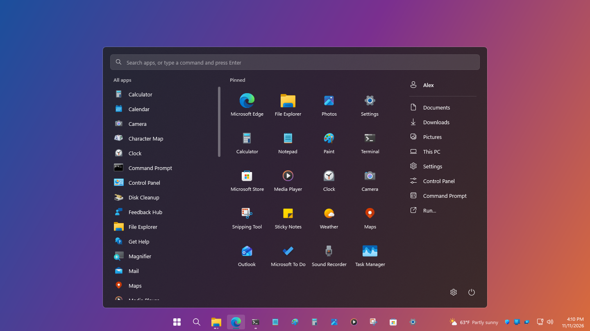
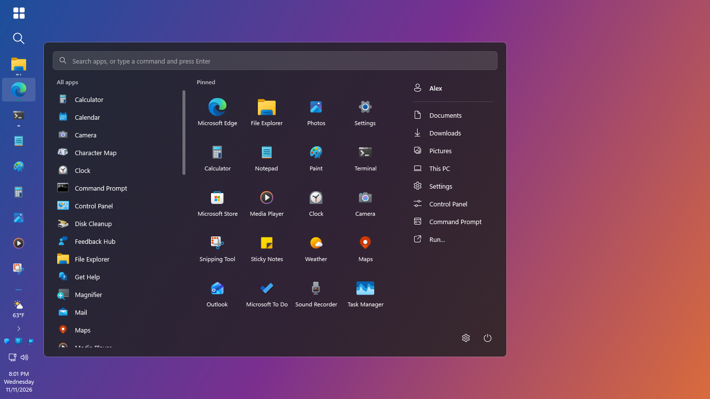
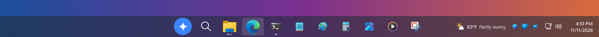
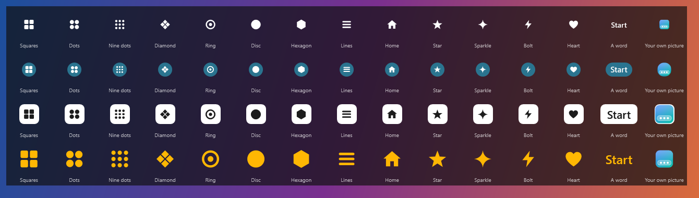
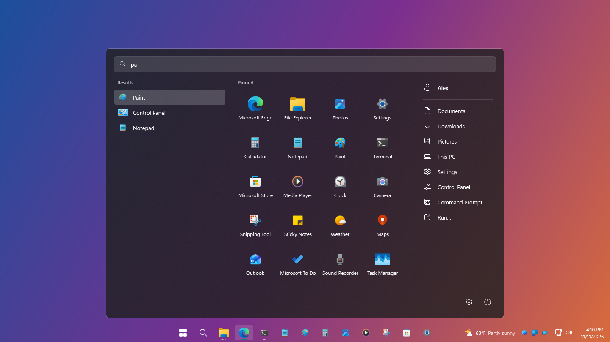
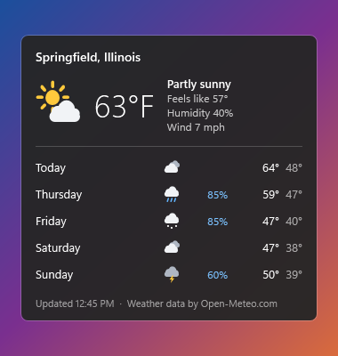
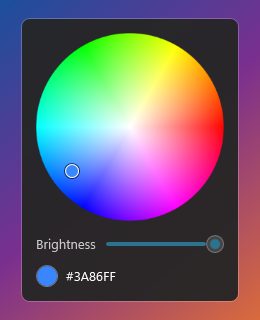
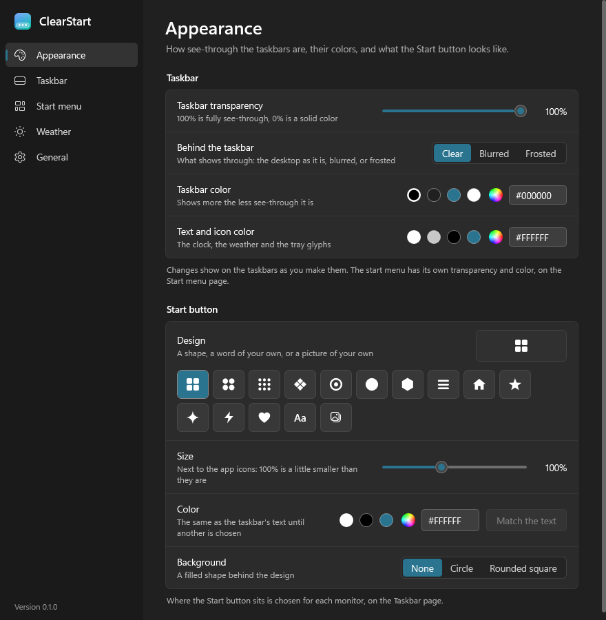

<p align="center">
  
</p>

<h1 align="center">ClearStart</h1>

<p align="center">
  A see-through taskbar on every monitor and a start menu you can shape,<br>
  in one small app for Windows 11.
</p>

<p align="center">
  
  
  
  <a href="LICENSE"></a>
</p>

<p align="center">
  
</p>

ClearStart draws its own taskbar and its own start menu. It runs as an ordinary program: nothing
is injected into Explorer, and closing it brings the Windows taskbar straight back.

> [!IMPORTANT]
> **This is an early preview.** Get the signed installer from the
> [latest release](https://github.com/C-Tech-Solutions/ClearStart/releases/latest), or build it
> from source. It has been run on one PC so far, in both **preview mode**, which runs next to the
> Windows taskbar and hides nothing, and **live mode**, where ClearStart takes the Windows
> taskbar's place. Start with the preview. [Where it stands](docs/status.md) has the full list.

The changes since 0.2.0 improve resize dragging, move bars without reopening them, and raise the
bars with the start menu over fullscreen apps. They have been built but not run on a desktop.
Start with Windows now prefers a sign-in task and hides Explorer's taskbar earlier, but cannot
guarantee that the Windows taskbar is never drawn. See [startup limits](docs/getting-started.md#how-soon-it-takes-over).

## Contents

- [What it does](#what-it-does)
- [A quick look](#a-quick-look)
- [Try it](#try-it)
- [Two ways to run it](#two-ways-to-run-it)
- [Getting the Windows taskbar back](#getting-the-windows-taskbar-back)
- [Guides](#guides)
- [Privacy](#privacy)
- [Built on](#built-on)
- [License](#license)

## What it does

| | |
| --- | --- |
| **A taskbar on every monitor** | Each monitor gets its own bar, set up on its own: top, bottom, left or right, any thickness, or no bar at all. |
| **See-through, your way** | Clear, blurred or frosted, with a transparency slider and any color laid over it. |
| **Only that screen's windows** | A bar lists the windows that are on its own monitor. |
| **One button per app** | All of an app's windows sit behind one button. Rest the mouse on it for live previews. |
| **Start where you want it** | With the apps, in the corner, at the far end, or hidden, monitor by monitor. Fifteen designs, including a word or a picture of your own. |
| **Pinned apps, bar by bar** | On every bar, on the main bar only, or a chosen few on each. |
| **A start menu that is yours** | Search, all apps, pinned tiles, and a list of places you can edit line by line. |
| **Weather on the bar** | Temperature and conditions next to the clock, with a five-day panel. No account needed. |
| **Sound and network menus** | Switch the output device or open the mixer from a right-click. The network glyph shows wired, Wi-Fi or no connection. |
| **A real settings window** | Everything in one place, and changes show on the bars as you make them. |

## A quick look

### Put the bar anywhere

Top, bottom, or either side, and each monitor can differ. Drag a bar's edge to make it thinner or
thicker; the icons follow.

<p align="center">
  
</p>

| | |
| --- | --- |
| The default bar |  |
| Thin, 28 pixels |  |
| Thick, with the day on the clock |  |
| Start in the corner |  |
| Start at the far end |  |
| Window titles, apps at the start |  |

### Make it look like yours

Pick how see-through the bar is, what shows behind it, its color, and the Start button's design.

<p align="center">
  
</p>

<p align="center">
  
</p>

### The start menu

Type to search, click a tile, or jump to a place. The column of places is yours to edit: folders,
programs, files, web addresses, Windows settings pages.

<p align="center">
  
</p>

### Weather, colors and settings

<table>
  <tr>
    <td align="center" valign="top"><br>The weather panel</td>
    <td align="center" valign="top"><br>The color wheel</td>
  </tr>
</table>

<p align="center">
  
</p>

<sub>These pictures are drawn by the app itself (`ClearStart.exe --screenshots`) with stand-in
content: the default settings, apps that come with Windows, a made-up name and a sample forecast,
over a plain gradient in place of a wallpaper.</sub>

## Try it

**You need** 64-bit Windows 11.

**1. Install it**

Download `ClearStart-Setup-<version>.exe` from the
[latest release](https://github.com/C-Tech-Solutions/ClearStart/releases/latest) and run it. It is
one file of about 55 MB, signed by C-Tech Solutions LLC, and carries its own copy of .NET, so the
PC needs nothing else. It installs for you alone, by default into
`%LOCALAPPDATA%\Programs\ClearStart`, without administrator rights, and uninstalls from Windows'
list of apps. If you choose another folder in Setup, use it in the commands below.

Setup's last page has **Start ClearStart now** ticked, which starts
[live mode](#two-ways-to-run-it). To start with the preview, untick it.

**2. Start the preview**

```powershell
& "$env:LOCALAPPDATA\Programs\ClearStart\ClearStart.exe" --preview
```

ClearStart's bars appear next to the Windows taskbar. Nothing of Windows' is hidden or changed.

**3. Look around**

- Click **Start** to open the start menu, or the **magnifier** next to it for Windows Search.
- **Right-click an empty part of a bar** to move it, hide it, or open **Settings**.
- **Drag the edge** of a bar that faces the desktop to resize it.

**4. Close it**

Right-click a bar and choose **Exit ClearStart**, or run:

```powershell
& "$env:LOCALAPPDATA\Programs\ClearStart\ClearStart.exe" --exit
```

[Getting started](docs/getting-started.md) goes through this step by step. An installed copy
keeps itself up to date from the releases here: see [Updates](docs/updates.md).

**Or build it from source**

This needs the [.NET 10 SDK](https://dotnet.microsoft.com/download/dotnet/10.0).

```powershell
git clone https://github.com/C-Tech-Solutions/ClearStart.git
cd ClearStart
dotnet build src/ClearStart.csproj -c Release
src\bin\Release\net10.0-windows\ClearStart.exe --preview
```

`src\bin\Release\net10.0-windows\ClearStart.exe --exit` closes it. A copy built this way says
when a newer version is out, but does not install it.

**Or build the installer yourself**

```powershell
installer\build-installer.ps1
```

This makes `artifacts\installer\ClearStart-Setup-<version>.exe`. Building it needs
[Inno Setup 6](https://jrsoftware.org/isdl.php) as well. It is not signed unless you sign it, so
Windows warns before running it, and the copy it installs does not update itself. See
[the installer](docs/getting-started.md#the-installer).

## Two ways to run it

| | Preview | Live |
| --- | --- | --- |
| Command | `ClearStart.exe --preview` | `ClearStart.exe` |
| Windows taskbar | Stays where it is | Hidden while ClearStart runs |
| Tray icons from your apps | Not shown | Shown on the bars |
| Windows key | Opens the Windows start menu | Opens ClearStart's start menu |
| Has it been run? | Yes, on a four-monitor desktop | Yes, on the same desktop |

## Getting the Windows taskbar back

Closing ClearStart puts the Windows taskbar back. If a copy was ended without the chance to clean
up (from Task Manager, say) and the Windows taskbar stays hidden, run:

```powershell
& "$env:LOCALAPPDATA\Programs\ClearStart\ClearStart.exe" --restore
```

For a copy you built from source:

```powershell
src\bin\Release\net10.0-windows\ClearStart.exe --restore
```

Uninstalling does the same before it removes anything. None of this can happen in a preview,
because a preview never hides the Windows taskbar.

Signing out with Start with Windows enabled leaves Windows' taskbar on auto-hide to reduce its
visibility at the next sign-in. Normal Exit and `--restore` restore its previous setting. See
[sign-out and recovery](docs/getting-started.md#between-signing-out-and-signing-in).

## Guides

| Guide | What is in it |
| --- | --- |
| [Getting started](docs/getting-started.md) | Installing or building it, the first run, closing it, the installer, starting with Windows, removing it |
| [The taskbar](docs/taskbar.md) | Moving and resizing bars, app buttons, pinned apps, the search button, the clock, sound, network and weather |
| [The start menu](docs/start-menu.md) | Searching, pinned tiles, and the list of places |
| [The settings window](docs/settings.md) | Every page, the Start button designs, colors, and clear, blurred and frosted |
| [The settings file](docs/settings-file.md) | Every key in `settings.json`, with its default |
| [Updates](docs/updates.md) | How ClearStart checks for a new version, what it sends, how it checks a download, which copies install updates, and how to turn it off |
| [Where it stands](docs/status.md) | What works, what is missing, and what has not been tried yet |
| [Development](docs/development.md) | How the code is laid out, the self-test, how the pictures here are made, and building, signing and publishing the installer |

## Privacy

ClearStart has no account and no telemetry. It fetches two things:

- **The weather**, from [Open-Meteo](https://open-meteo.com/), and only after you choose a location:
  the place name you type is sent once to look it up, and after that only the place's coordinates,
  rounded to about half a mile, and the units. Windows' location service is not used. Turning the
  weather off stops the requests.
- **Whether there is a newer version**, from GitHub, about once a day. The request carries
  ClearStart's version and nothing about you or the PC. Updates are only installed when you click
  **Install**, or when you have turned on installing them automatically. Turning the check off in
  the settings stops the requests. See [Updates](docs/updates.md).

## Built on

- [ManagedShell](https://github.com/cairoshell/ManagedShell) (Apache-2.0) for docking the bars,
  the window list and the tray icons.
- Weather data by [Open-Meteo.com](https://open-meteo.com/).

See [THIRD-PARTY-NOTICES.md](THIRD-PARTY-NOTICES.md).

## License

ClearStart is released under the [MIT License](LICENSE). The libraries and data it uses keep
their own licenses; see [THIRD-PARTY-NOTICES.md](THIRD-PARTY-NOTICES.md).

---

<sub>If you have used tools such as TranslucentTB or StartAllBack, ClearStart covers the same
ground in one program. It is an independent project and is not affiliated with those tools or
with Microsoft. Windows is a trademark of the Microsoft group of companies.</sub>
