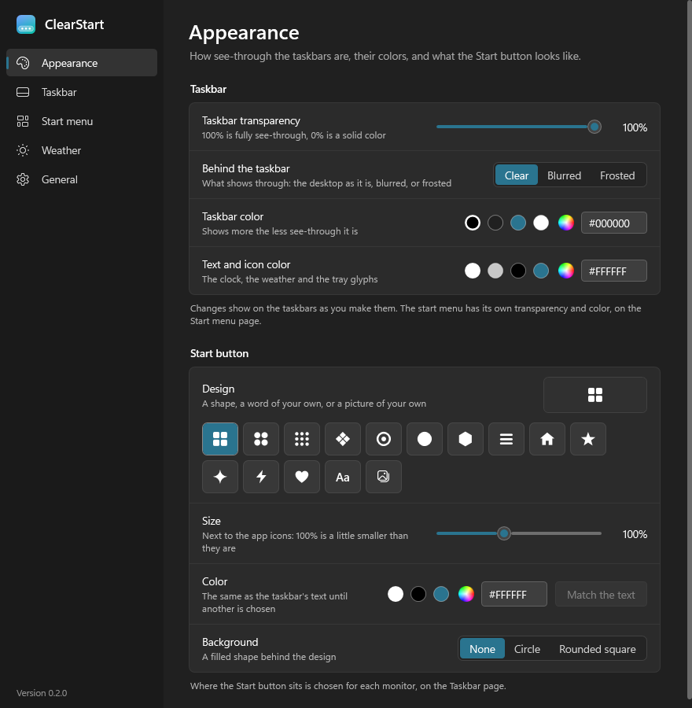
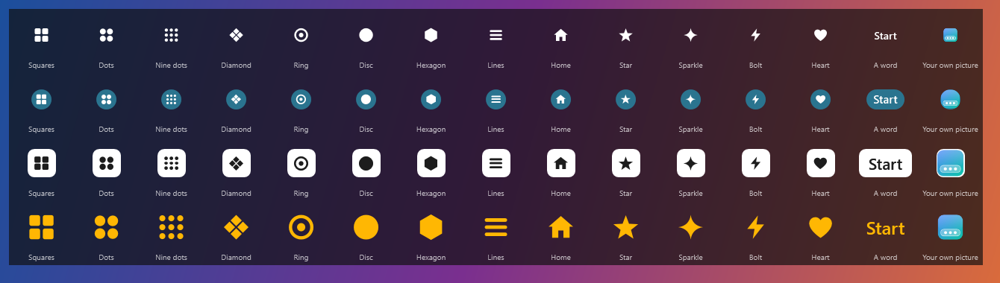
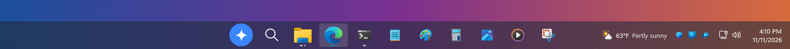
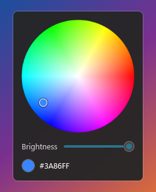
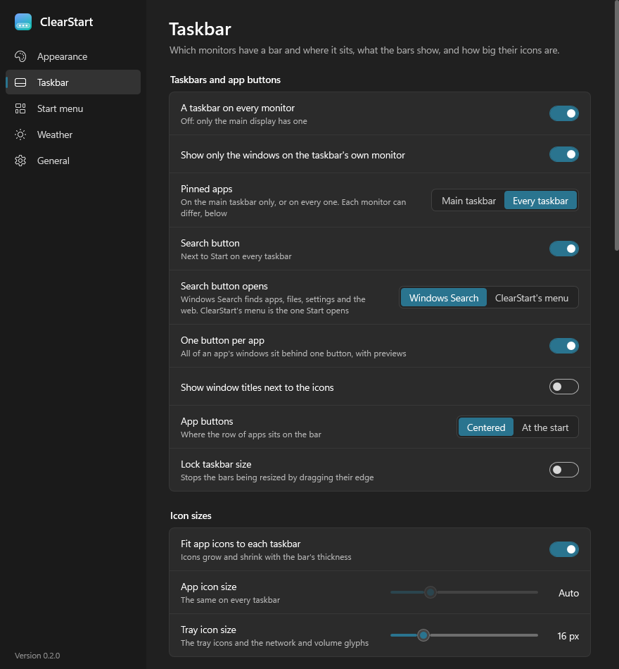
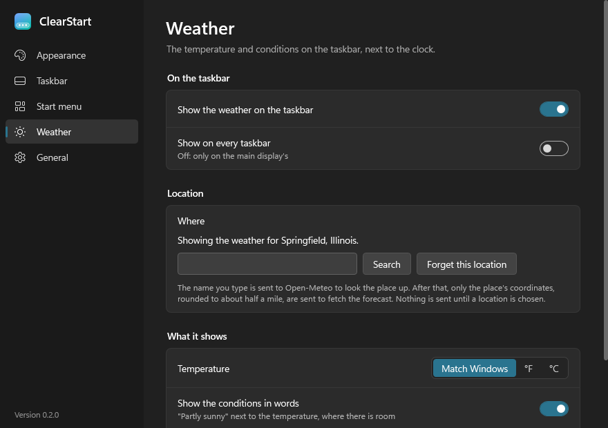

# The settings window

[← Back to the README](../README.md)

Right-click a bar and choose **Settings**, or click the gear in the start menu. Changes take
effect as you make them and are saved to [the settings file](settings-file.md).

- [The pages](#the-pages)
- [Appearance](#appearance)
- [The Start button](#the-start-button)
- [Colors](#colors)
- [Clear, blurred, frosted](#clear-blurred-frosted)
- [Taskbar](#taskbar)
- [Weather](#weather)
- [General](#general)

## The pages

| Page | What is on it |
| --- | --- |
| **Appearance** | How see-through the bars are, what shows behind them, their color, the color of the text and glyphs, and the Start button's design |
| **Taskbar** | Which monitors have a bar and where it sits, what the bars show, and how big the icons are |
| **Start menu** | How the menu opens, its size and look, and the list of places. See [the start menu](start-menu.md) |
| **Weather** | Show or hide, location, units, and how often to update |
| **General** | Start with Windows, updates, the settings file, the log folder, the version, exit |

## Appearance

  

| Setting | What it does |
| --- | --- |
| Taskbar transparency | 100% is fully see-through, 0% is a solid color |
| Behind the taskbar | Clear, blurred or frosted. See [below](#clear-blurred-frosted) |
| Taskbar color | The color laid over the bar. It shows more the less see-through the bar is |
| Text and icon color | The clock, the weather and the tray glyphs |

Sliders and colors change the bars as you drag.

## The Start button

Fifteen designs, the same on every bar:

  

- **Thirteen shapes:** squares, dots, nine dots, diamond, ring, disc, hexagon, lines, home, star,
  sparkle, bolt, heart.
- **A word of your own**, up to 16 characters. It shrinks to fit a narrow bar.
- **A picture of your own:** a PNG, JPG, GIF, BMP or ICO file.

A small preview next to the designs shows the button as it will be on the bar. Under the designs:

| Setting | What it does |
| --- | --- |
| Size | Its size next to the app icons, 60% to 160% |
| Color | The text color until another is chosen. A picture keeps its own colors |
| Background | A filled circle or rounded square behind the design, in the Windows accent color until another is chosen |

If the picture file cannot be shown, the page says so and the bars show the squares.

Put together, a frosted bar with a tint and a sparkle on a blue circle looks like this:

  

Where the Start button sits is chosen for each monitor, on the Taskbar page or from a bar's
right-click menu.

## Colors

Each color row has a few ready-made swatches, a color wheel and a `#RRGGBB` box.

  

On the wheel the hue goes round, the color gets stronger from the middle outwards, and the slider
under it sets the brightness. Click or drag, and the bars follow as you go.

## Clear, blurred, frosted

| Choice | What shows behind the bar |
| --- | --- |
| **Clear** | The desktop as it is |
| **Blurred** | The desktop out of focus |
| **Frosted** | The same blur with a faint milky grain over it |

In all three the color is laid on top, as solid as the transparency slider says: at 100%
see-through there is no color at all. How strong the blur is belongs to Windows and cannot be
set.

## Taskbar

  

**Taskbars and app buttons**

| Setting | What it does |
| --- | --- |
| A taskbar on every monitor | Off: only the main display has one |
| Show only the windows on the taskbar's own monitor | Off: every bar lists every window |
| Pinned apps | On the main taskbar only, or on every one. Each monitor can differ, further down the page |
| Search button | The magnifier next to Start, on every bar |
| Search button opens | Windows Search (the default), or ClearStart's menu. See [the search button](taskbar.md#the-search-button) |
| One button per app | All of an app's windows sit behind one button, with previews |
| Show window titles next to the icons | Titles beside the icons of running apps |
| App buttons | Centered, or at the start of the bar |
| Lock taskbar size | Stops the bars being resized by dragging their edge |

**Icon sizes**

| Setting | What it does |
| --- | --- |
| Fit app icons to each taskbar | Icons grow and shrink with the bar's thickness |
| App icon size | One size on every bar, when the switch above is off |
| Tray icon size | The tray icons and the network and volume glyphs |

**Each monitor**

A row for every monitor: whether it has a bar, which edge the bar is on, where its Start button
sits, and which pinned apps it shows (all, a chosen few, or none).

**Tray and clock**

| Setting | What it does |
| --- | --- |
| Tray icons | The icons apps put next to the clock: on the main bar, or on every bar |
| Clock, network and volume | On the main bar, or on every bar |
| Network and volume button | Click it for quick settings; right-click for sound or network options |
| Cast button | Off at first. Opens the Windows Cast panel, the one Windows+K opens. See [Cast](taskbar.md#cast) |
| Show seconds on the clock | On or off |

Sliders, colors, the pinned apps choices and the search button change the bars in place. The
other switches in the first and last groups reopen the bars, which takes a few seconds.

## Weather

  

| Setting | What it does |
| --- | --- |
| Show the weather on the taskbar | On or off |
| Show on every taskbar | Off: only on the main display's |
| Where | Type a place and press **Search**, then pick it. **Forget this location** stops the requests |
| Temperature | Match Windows, °F or °C |
| Show the conditions in words | "Partly sunny" next to the temperature, where there is room |
| Update every | 5 to 240 minutes; 15 by default |

What is sent, and when, is under [Weather](taskbar.md#weather) in the taskbar guide.

## General

| Setting | What it does |
| --- | --- |
| Start with Windows | Starts ClearStart when you sign in. See [Getting started](getting-started.md#start-with-windows) |
| Updates | The version you are running and what the updater is doing, with **Check now**. Once a newer version is out, **Install** and **What's new** join it. A copy that does not update itself shows **Download** instead, which opens the release on GitHub, and says why under the switches. See [Updates](updates.md) |
| Check for updates automatically | On by default: asks GitHub about once a day |
| Install updates automatically | Off by default: downloads a newer version as soon as an automatic check finds one, and installs it once nobody has used the PC for ten minutes. It needs **Check for updates automatically** on |
| Settings file | Where the settings are saved, and a button that opens the file in Notepad |
| Log folder | Where the log is, with what ClearStart did and anything that went wrong, and a button that opens the folder |
| About | The version you are running, whether it runs in the Windows taskbar's place or as a preview, and a button to exit ClearStart |
