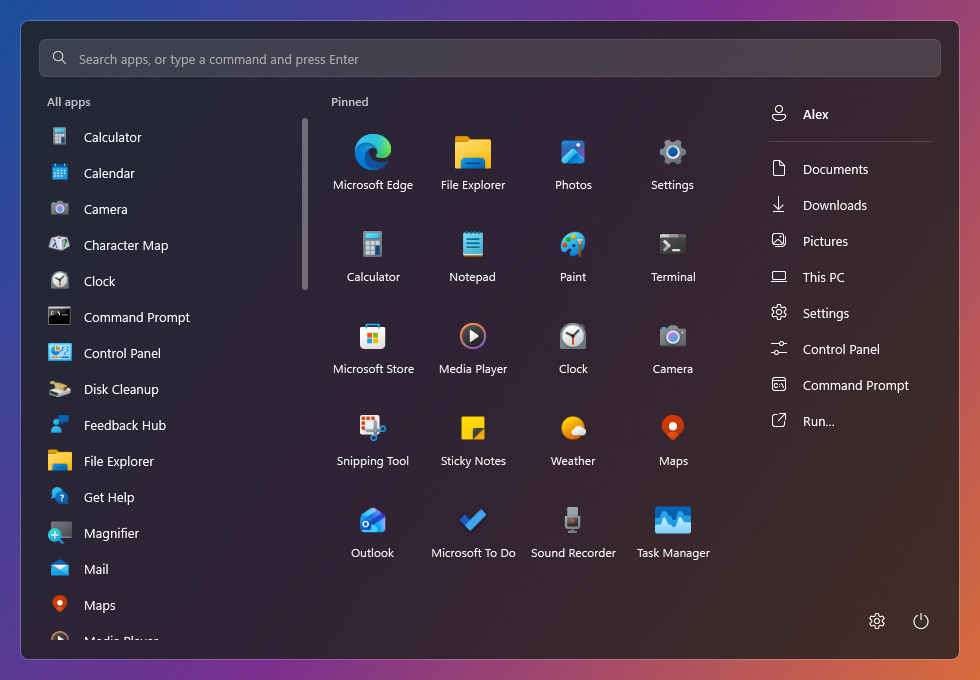
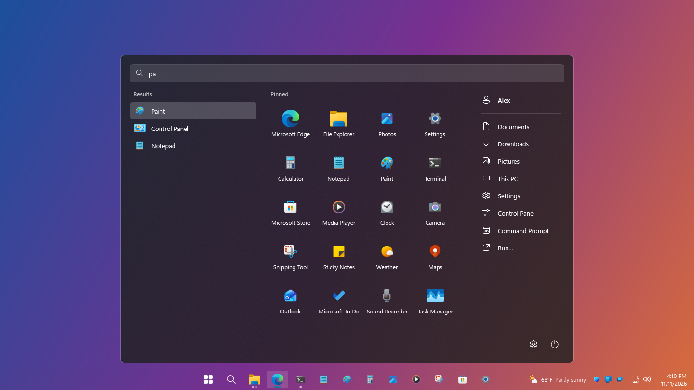
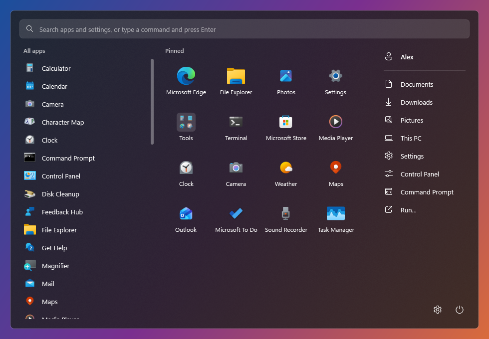
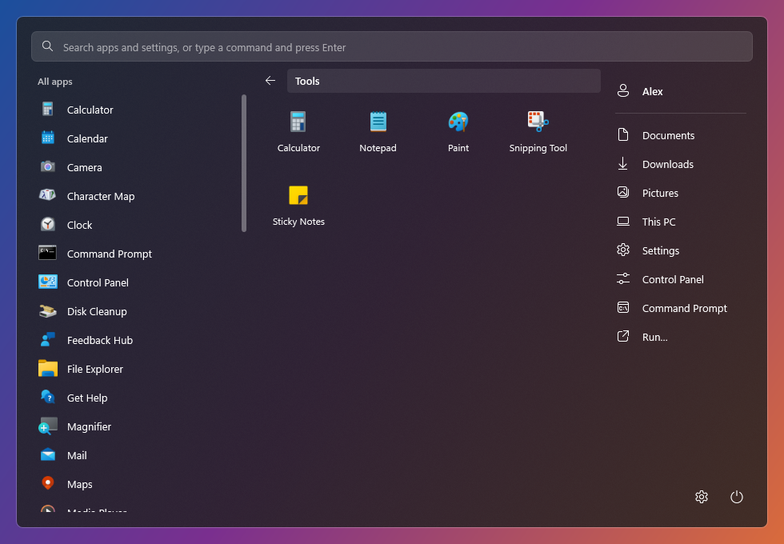
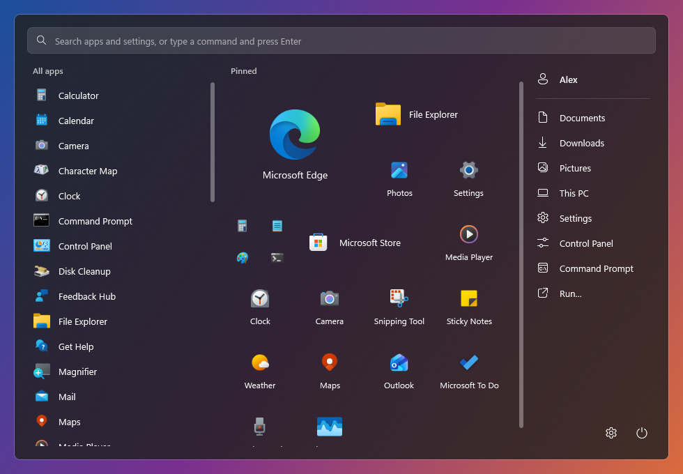
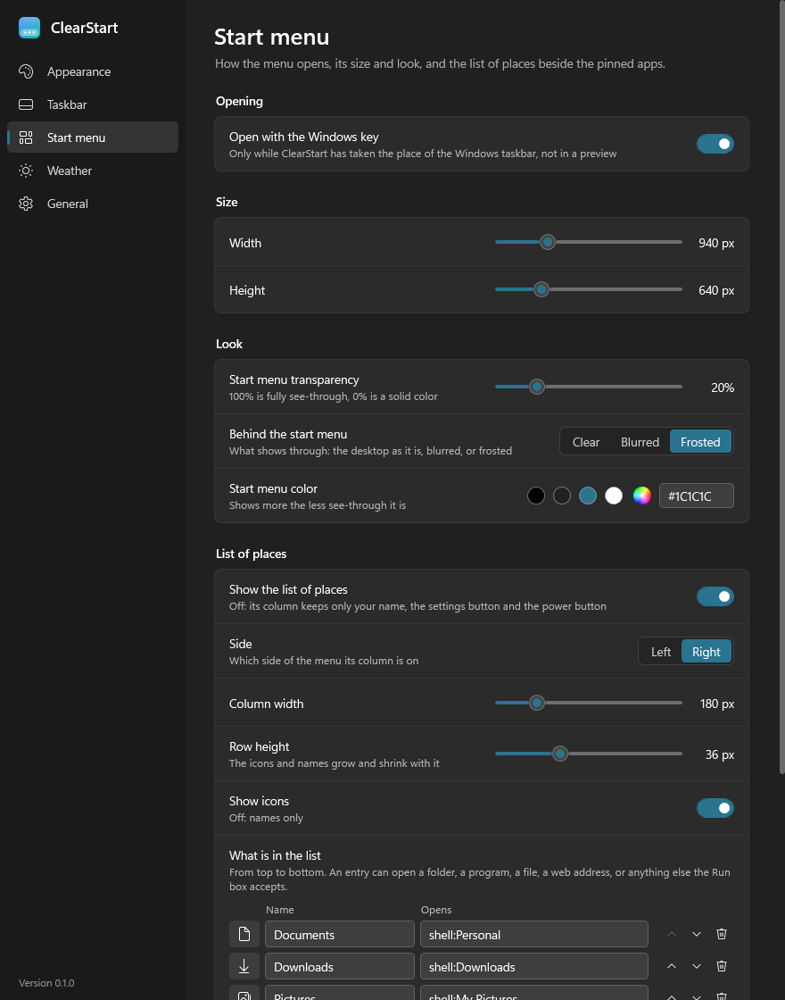

# The start menu

[← Back to the README](../README.md)

  

The menu opens from the **Start** button, and in live mode from the Windows key. It opens against
the bar it was opened from.

While the menu is open, ClearStart raises all its bars above fullscreen windows too. Closing the
menu by the Windows key, Esc, clicking elsewhere, or closing its window returns the bars to their
normal fullscreen behavior. This change has been built but has not been tested on a desktop yet.

It has four parts:

| Part | What it is |
| --- | --- |
| **Search box** | Across the top. The cursor is already in it when the menu opens. |
| **All apps** | Every app on the PC, in a list. |
| **Pinned** | Your pinned apps, as tiles. |
| **Places** | A column with your name at the top, a list of places you choose, and the settings and power buttons at the bottom. |

## Using it

| Action | Result |
| --- | --- |
| Type | Searches the apps, and from the second letter Windows' settings and tools too. The arrow keys move through the results; Enter opens the highlighted one or the first match. When nothing matches, Enter runs what was typed as a command. Esc clears the search, then closes an open folder, then closes the menu |
| Click an app or a pinned tile | Opens it. Ctrl+Shift+click on a tile opens it as administrator |
| Right-click an app or a pinned tile | Open, run as administrator, pin or unpin from Start and the taskbar, open file location, properties. A pinned tile also has its [size](#tile-sizes), move to front, move to a folder (or a new one), take out of its folder, and sort A to Z. Properties is Windows' own Properties window: for a pinned shortcut the shortcut's, for a program the program's. A Store app has none, so it is greyed out |
| Drag a pinned tile | Moves it among the pins. Dropped on another tile, it makes a folder of the two; dropped on a folder, it goes in |
| Drag an app from the list onto the pins | Pins it where it is dropped: between tiles, into a folder, or onto a tile to make a folder of the two |
| Click a folder | Opens it in place of the pins. The arrow goes back; a tile dropped on the arrow comes out of the folder. Click the name to rename it |
| Right-click a folder | Open, rename, size, move to front, sort its apps A to Z, ungroup |
| Right-click the space among the pins | Sort A to Z |
| Right-click a Windows setting or tool | Open, run as administrator (not for a settings page), add to or remove from the places |
| Click a place | Opens it |
| Right-click a place | Open, properties (for a folder, a file or a `shell:` location), move up or down, add a line below, remove, or "Customize this list…" for the settings page |
| Your name | Opens your account page in Windows' settings |
| The gear | Opens Windows' settings. Right-click it for ClearStart's settings, at the Start menu page |
| The power button | Lock, sign out, sleep, restart, shut down |

  

The menu's search finds apps, runs commands, and finds about seventy of Windows' settings pages,
Control Panel items and tools: Power Options, Control Panel, Programs and Features, Device Manager,
Disk Management, Services, Registry Editor, Display settings and so on. Each shows under its name
whether it is a settings page, a Control Panel item or a Windows tool. They also come up by other
words people use for them, such as "uninstall", "dark mode" or "environment variables", and by
the command that opens them, such as "regedit". At the same match an app comes first. Shut down, restart and sleep are left out, so Enter cannot turn the PC off by accident; they
are on the power button. Tools this edition of Windows does not have, such as the Group Policy
editor on Home, are left out too.

For files and the web, click the [search button](taskbar.md#the-search-button) next to Start, which
opens Windows Search.

## Folders of pins

Drop one pinned tile on another to put them in a folder. The folder's tile shows its first four
apps; click it to open it. The folder opens out of its tile, on a card of its own, and closes back
into it.

While you drag a tile or an app, its icon floats under the pointer. Let go and it flies into its
new place while the other tiles slide aside; let go anywhere else and it flies back. A tile you
can drop into grows a little as you pass over it. All of this follows Windows' animation effects
setting: with animations off, things just move.

  
  

The apps in a folder still count as pinned to Start. Unpinning the last app in a folder removes
the folder. The folders are kept in ClearStart's settings file.

## Tile sizes

Right-click a pinned tile or a folder and choose **Size**: small, medium, wide or large. A wide
tile takes the place of two medium ones side by side, a large one two by two, and four small ones
share the place of one. A small tile shows only its icon; a large one shows a bigger icon.

  

The tiles keep their order, row by row. Each goes in the first place after the one before it
that it fits in, so a wide tile that does not fit at the end of a row starts the next one and
leaves a gap. Where only one medium tile fits across (a narrow menu, or tiles drawn big), wide and
large tiles are drawn medium. A folder made on a tile takes that tile's size. The sizes are kept in
ClearStart's settings file.

To draw all the tiles bigger or smaller, use **Settings → Start menu → Pinned tile scale**
(70% to 150%). Bigger tiles fit fewer across.

## The list of places

The column beside the pinned apps is yours to change, under **Settings → Start menu → List of
places**.

  

The column itself can be:

- switched off (your name and the settings and power buttons stay);
- put on the left or the right;
- made 140 to 340 wide;
- given rows 28 to 52 tall (the icons and names grow and shrink with them);
- shown with or without icons.

Under that is the list, a line for each entry:

| Part of a line | What it does |
| --- | --- |
| The icon | Opens a sheet of 56 icons to pick from |
| Name | What the menu shows |
| Opens | What clicking it opens: a folder, a program, a file, a web address, a `shell:` or `ms-settings:` location, or anything else the Run box accepts |
| The arrows and the bin | Move the entry up or down, or remove it |

**Add…** offers:

- ready-made entries: folders such as Music, Videos and Desktop; Windows pages such as Installed
  apps, Programs and Features (the Control Panel's list for removing a program) and Windows
  Update; tools such as Task Manager and Terminal;
- a folder, or a program or file, chosen from disk;
- an empty entry to type a web address or command into;
- a divider line, to split the list into groups.

Entries already in the list are greyed out. **Reset to the default list** puts back the eight
entries it started with.

## Size and look

Also on the Start menu page:

| Setting | What it does |
| --- | --- |
| Open with the Windows key | In live mode, the Windows key opens this menu |
| Width, Height | The menu's size |
| Pinned tile scale | How big the pinned tiles are drawn, 70% to 150%. Each tile's own size is on its right-click menu |
| Start menu transparency | 100% is fully see-through, 0% a solid color |
| Behind the start menu | Clear, blurred or frosted |
| Start menu color | The color laid over it |

Changes on this page show the next time the menu opens.
