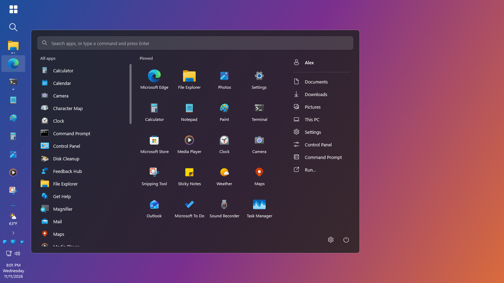
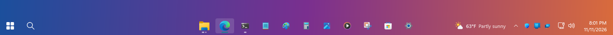
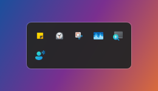
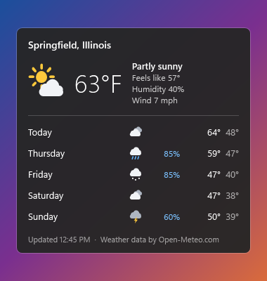

# The taskbar

[← Back to the README](../README.md)

Each monitor has its own bar, and each bar is set up on its own.

  

From left to right: **Start**, the **search button**, the **app buttons**, the **weather**, the
**tray icons** with the arrow for the hidden ones, **network and volume**, and the **clock**. A
[Cast](#cast) button can join them. While a newer version of ClearStart is out, a download button
with a blue dot sits on the main bar next to the weather; see [Updates](updates.md).

- [The bar's right-click menu](#the-bars-right-click-menu)
- [Moving and resizing](#moving-and-resizing)
- [The Start button](#the-start-button)
- [The search button](#the-search-button)
- [App buttons](#app-buttons)
- [Pinned apps, bar by bar](#pinned-apps-bar-by-bar)
- [Monitors without a bar](#monitors-without-a-bar)
- [Tray icons](#tray-icons)
- [Cast](#cast)
- [The clock](#the-clock)
- [Network and volume](#network-and-volume)
- [Weather](#weather)

## The bar's right-click menu

Right-click an empty part of a bar:

| Entry | What it does |
| --- | --- |
| Show desktop | Minimizes everything; again brings the windows back. |
| Task Manager | Opens it. |
| Move this taskbar | Top, Bottom, Left side, Right side, or the same place as the Windows taskbar (the default). |
| Start button | With the app buttons, in the corner at the start of the bar, at the far end, or hidden. "Use this on every taskbar" copies the choice to all bars. "Change its design…" opens the settings at the Start button's designs. |
| Pinned apps on this taskbar | Which pinned apps this bar shows: all of them, only the ticked ones, or none. Below that are the pinned apps themselves; clicking one puts it on this bar or takes it off. |
| Hide / Show the search button | Takes the search button off every bar, or puts it back. |
| Hide this taskbar | Takes the bar off this monitor altogether. Greyed out on the last bar left. |
| Show the taskbar on | Appears once a bar is hidden: lists the monitors without one, to bring a bar back. |
| Lock / Unlock taskbar size | Stops, or allows, resizing by dragging. |
| Settings | Opens [the settings window](settings.md). |
| Exit ClearStart | Closes it. In live mode this brings the Windows taskbar back. |

## Moving and resizing

**Move a bar** from its right-click menu (**Move this taskbar**) or from the Taskbar page of the
settings. A bar can sit on any of the four edges.

  

**Resize a bar** by dragging the edge that faces the desktop. Top and bottom bars go from 28 to
120 thick, side bars from 56 to 240. The icons grow and shrink with the bar unless you set a fixed
size in the settings.

| | |
| --- | --- |
| Thin (28) |  |
| Default (44) |  |
| Thick (72) |  |

A bar on a small second monitor (under 900 long when flat, under 600 when on its side) leaves out
the tray icons, clock and weather to make room for app buttons.

## The Start button

It can sit in four places, chosen for each bar from its right-click menu or the settings:

| | |
| --- | --- |
| With the apps (the default) |  |
| In the corner |  |
| At the far end |  |
| Hidden | The bar has no Start button; the search button stays with the apps. |

What it looks like is chosen once for every bar. See
[the Start button's designs](settings.md#the-start-button).

## The search button

A magnifier next to Start, on every bar. It goes wherever Start goes (on Start's inner side when
Start is at the far end), and when Start is hidden it sits with the app buttons.

It can open one of two things:

| Choice | What a click opens |
| --- | --- |
| **Windows Search** (the default) | Windows' own search, the one Win+S opens. It finds apps, files, settings and the web. |
| **ClearStart's menu** | The start menu with the cursor in its search box, so what you type next is the search. Finds apps and runs commands. This is also what Start opens. |

Choose under **Settings → Taskbar → Search button opens**, or right-click the button:

| Entry | What it does |
| --- | --- |
| Opens Windows Search | Makes a click open Windows Search. |
| Opens ClearStart's search | Makes a click open the start menu. |
| Hide the search button | Takes it off every bar. A bar's right-click menu or the Taskbar page brings it back. |
| Taskbar settings | Opens the settings at the Taskbar page. |

## App buttons

Each app has one button, with all of its windows behind it. A bar lists only the windows that are
on its own monitor. A mark under a button means the app is open, two marks mean it has more than
one window, and the app in front is highlighted.

| Action | Result |
| --- | --- |
| Rest the mouse on a running app | Small live previews of its windows open next to the button |
| Click, app not running | Opens it |
| Click, one window | Brings it to the front, or minimizes it if it already was |
| Click, several windows | Opens the previews at once; click one to switch to it |
| On a preview: the × or a middle-click | Closes that window |
| Shift+click or middle-click | Opens a new window |
| Ctrl+Shift+click | Opens a new window as administrator |
| Right-click | New window, pin or unpin, show or hide its pin on this taskbar, open file location, minimize / maximize / close |
| Mouse wheel over the buttons | Scrolls them when there are more than fit |

With **Show window titles next to the icons** on, running apps show their title too:

  

Both **One button per app** and the titles are on the Taskbar page of the settings. With one
button per app switched off, every window gets a button of its own.

## Pinned apps, bar by bar

The pinned apps can be on every bar or on the main bar only (**Settings → Taskbar → Pinned
apps**), and each bar can go its own way: all of them, none, or a chosen few.

Choose them in any of three places:

- the bar's right-click menu, under **Pinned apps on this taskbar**;
- a pinned app's right-click menu, with **Hide its pin from this taskbar**;
- the chips for each monitor on the Taskbar page of the settings.

Good to know:

- A bar that shows no pin for an app still shows that app's button while it has a window on that
  bar's monitor. Right-click it for **Show its pin on this taskbar**.
- An app pinned from a bar is put on that bar.
- Switching between every bar and the main bar resets the bars that were set to all or none, and
  leaves alone a bar with a chosen few.
- Until you pin or unpin something in ClearStart, it follows what is pinned in Windows.

## Monitors without a bar

A monitor whose bar is hidden has no bar at all, and its windows are listed on the main bar
instead.

The main bar is the main display's. If that one is hidden, it is the first monitor that still has
a bar, which then also carries the tray icons, clock and weather when those are not on every bar.
One monitor always keeps its bar, so there is a way back to the settings.

## Tray icons

Only the tray icons you choose sit on the bar. The rest wait behind the arrow beside them, as in
Windows. At first only the battery icon (on a laptop) is on the bar.

Windows' own network and volume icons are left out, because ClearStart's
[network and volume button](#network-and-volume) next to the clock does their job. Switch that
button off in the settings and they come back, behind the arrow.

  

| Action | Result |
| --- | --- |
| Click the arrow | Opens the hidden icons. Click anywhere else, or press Esc, to close them |
| Drag an icon from the panel onto the bar | Keeps it on the bar, where you drop it. A line shows the spot |
| Drag an icon along the bar | Moves it |
| Drag an icon from the bar onto the arrow or into the panel | Hides it behind the arrow again |
| Click, double-click or right-click an icon | Goes to its app, on the bar or in the panel |

Hold an icon on the arrow for a moment and the panel opens, so you can drop it in. Every bar shows
the same icons, and the choice is kept in the settings file as
[`taskbar.pinnedTrayIcons`](settings-file.md#taskbar). Tray icons need live mode: a preview has
none.

## Cast

A screen with waves. A click opens Windows' Cast panel, the one Windows+K opens: pick a wireless
display or a TV to show the screen on, or disconnect from one.

It is off at first. Switch it on under **Settings → Taskbar → Cast button**, and it sits between
the tray icons and the network glyph, on every bar that has the clock.

## The clock

The clock shows the time and the date. When there is room it adds **the day of the week** between
them:

- on a top or bottom bar, once the bar is thick enough for three lines (about 56 and up);
- on a side bar, once it is wide enough for the longest day's name, so the clock keeps one shape
  all week.

  

A very thin bar shows the time alone. Seconds can be switched on in the settings, and the clock
can be on every bar or on the main one only.

## Network and volume

The network glyph follows the connection:

| Glyph | Meaning |
| --- | --- |
| A wired plug | On a cable |
| The Wi-Fi fan, with its signal strength | On Wi-Fi |
| A globe with a cross | No network |
| A warning version of the wired or Wi-Fi glyph | Connected, but no internet |

Clicking either glyph opens Windows' quick settings. Right-clicking gives a menu for the one under
the mouse.

**Volume**

| Entry | What it does |
| --- | --- |
| Open Sound settings | The Windows page |
| Open Volume mixer | The classic mixer with a slider per app |
| Output device | Every output that is plugged in; pick one to play through it |
| Spatial sound | Off or Windows Sonic for Headphones. Other formats (Dolby, DTS) need their own app, so they are listed only while in use; "More spatial sound options" opens the Windows page |
| Sounds | The classic sound schemes window |
| Troubleshoot sound problems | Windows' sound troubleshooter |

If Windows refuses a switch made from this menu, its own settings page opens instead.

**Network:** Open Network & Internet settings, and Network connections.

## Weather

The weather sits before the tray icons: a picture, the temperature and, where there is room, the
conditions in words. Until a location is chosen it reads **Set location**; click it to choose one.

  

| Action | Result |
| --- | --- |
| Click | Opens a panel with the weather now (feels like, humidity, wind) and the next five days |
| Right-click | Refresh now, set location, units, show conditions in words, show on every taskbar, hide |

The forecast comes from [Open-Meteo](https://open-meteo.com/), which needs no account. The place
name you type is sent to it once to look the place up. After that only the place's coordinates,
rounded to two decimals (about half a mile), and the units are sent, every 15 minutes by default.
Nothing is sent until a location is chosen, and Windows' location service is not used.
